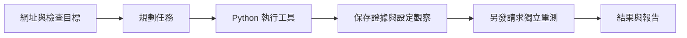

# Sentinel Mini

Sentinel Mini 讓你在自己的電腦檢查網站設定，並取得附有請求證據與重測結果的報告。這是一個 Python 教學原型，適合用來理解 AI 如何規劃檢查、工具如何收集資料，以及程式如何確認同一項觀察能否再次出現。

專案提供繁體中文瀏覽器介面與命令列入口。預設由本機 Codex CLI 負責規劃和分析，沿用既有登入，不需要另設 API Key。實際網站請求與 TLS 檢查由 Python 執行，網頁版任務則保存在本機 SQLite 資料庫。

## 專案能做什麼

你提供一個有權限檢查的網址與目標說明，程式會建立任務、執行工具，再對設定觀察進行獨立重測。完成後，你可以在介面閱讀結果，或匯出報告供後續修正與比較。

| 功能 | 會取得什麼 | 說明 |
| --- | --- | --- |
| AI 規劃 | 任務清單與選取理由 | Codex 從安全標頭、TLS、Cookie 三類任務中選擇 |
| 安全標頭檢查 | CSP 與 nosniff 設定觀察 | 讀取指定頁面的成功 HTML 回應 |
| TLS 檢查 | 憑證到期日、信任鏈驗證結果、TLS 版本與 cipher | HTTPS 目標才執行固定 Python 子程序 |
| Cookie 檢查 | HttpOnly、Secure、SameSite 屬性觀察 | 依 Cookie 名稱辨識可能的工作階段用途，仍需人工確認 |
| 獨立重測 | 可重現、未再現或無法確認的狀態 | 另發 GET 請求比對設定，AI 無法直接改寫判定 |
| 證據與報告 | 回應標頭、本文片段、證據 ID 與修正建議 | 可匯出 JSON 與 Markdown |
| 歷史紀錄 | 網頁版任務與已取得的證據 | 重啟後保留，中斷任務會標記狀態 |
| 本機示範 | 設定缺口頁面及修正版本 | 規則模式可取得固定結果，不需模型服務 |

## AI 與工具如何分工

Codex 先從既有工具中選擇任務，Python 才依計畫操作指定頁面。工具收集到資料後，規則會找出待重測的設定觀察。確認階段另發請求，再由 Codex 整理結果摘要。



| 模式 | 規劃與分析方式 | 適合的用途 |
| --- | --- | --- |
| Codex AI | 呼叫已登入的本機 Codex CLI | 查看 AI 的任務理由、結果分析與摘要 |
| 規則模式 | 固定執行三類任務，不呼叫模型 | 第一次示範、重複比對修正前後的設定 |
| Compatible API | 呼叫另行設定的相容模型服務 | 使用已有的 Ollama 或其他相容服務 |

工具最多三個並行，模型呼叫循序執行，每項任務最多五次。Codex 僅能選取已登錄的工具，不能新增任意指令、網址或攻擊內容。詳細理由見[流程與限制](docs/流程與限制.md)。

## 完成後會看到什麼

介面會顯示各項任務、執行紀錄、設定觀察與對應證據。Markdown 報告整理目標、結果與修正建議，JSON 則保留完整結構及擷取的 HTTP 資料。可以先閱讀[已保存的 Codex 示範報告](examples/codex-demo.md)，了解輸出內容。

內建網站刻意缺少 CSP、nosniff 與三個 Cookie 屬性。規則模式會得到五項可重現的設定觀察，修正頁面則預期為零項。AI 模式可能只選取部分任務，因此結果數量未必相同。

目前只檢查指定頁面的部分設定，不登入、不爬取全站，也不測試 XSS、SQL injection 或業務邏輯。可重現代表同一設定再次出現，不代表已證明可利用漏洞。TLS 檢查會保存連線資訊，尚無將 TLS 失敗轉成獨立漏洞結果的重測規則。

## 操作方式

需要 Python 3.11 以上。執行程式只使用標準函式庫，不必安裝其他 Python 套件、Docker 或資料庫服務。Codex 模式另需已安裝並登入的 Codex CLI，介面找到執行檔後才會開放選項。

### 啟動並檢查本機網站

先解壓縮專案，在含有 `app.py` 的資料夾執行，或在 Windows 點兩下 `start.bat`：

```powershell
python app.py
```

啟動後保留終端視窗，再依序操作：

1. 開啟[本機操作介面](http://127.0.0.1:8765)。
2. 按 **填入本機測試網站**，目標會填入 `http://127.0.0.1:8766/`。
3. 已登入 Codex 時使用預設 **Codex AI**。若要先比對固定結果，改選 **規則模式**。
4. 勾選擁有檢查權限，按 **開始檢查**。
5. 任務結束後閱讀證據，再按 **匯出報告** 或 **匯出 JSON**。

內建網站使用 HTTP，因此 TLS 任務會顯示略過。若要比較修正結果，將目標換成 `http://127.0.0.1:8766/fixed`，再以規則模式建立任務。

在終端按 Ctrl+C 可停止服務。埠衝突時，使用 `python app.py --port 8865 --demo-port 8866` 改換連接埠。完整步驟與預期畫面文字見[使用說明書](docs/使用說明書.md)。

### 選擇後續文件

| 你要做的事 | 文件 |
| --- | --- |
| 從專案介紹開始，完成第一份報告 | [使用說明書](docs/使用說明書.md) |
| 檢查授權網站、備份或排錯 | [操作指南](docs/操作指南.md) |
| 查詢參數、環境變數與狀態 | [參數與結果參考](docs/參數與結果參考.md) |
| 理解 AI 分工與結果限制 | [流程與限制](docs/流程與限制.md) |
| 查閱模組設計與實際測試紀錄 | [設計與驗證](ARCHITECTURE.md) |

所有文件入口見[說明文件](docs/README.md)。

## CLI 與其他模型

先啟動網頁版提供本機測試網站，再開另一個終端：

```powershell
python app.py --target http://127.0.0.1:8766/ --authorized --ai --out data/demo.json
python app.py --target http://127.0.0.1:8766/fixed --authorized --out data/fixed.json
```

同時寫入 `.json`、`.md`。第一行用 Codex，第二行不加 `--ai` 為規則模式。completed 回傳 exit 0，partial/failed 回傳 1。CLI 匯出不加入網頁歷史。

另保留 OpenAI-compatible `/chat/completions` 模式。設定 `SENTINEL_LLM_BASE_URL`（含 `/v1`）、`SENTINEL_LLM_MODEL`，必要時加 `SENTINEL_LLM_API_KEY`，重啟後在介面選「其他 AI」。CLI 使用 `--ai --backend compatible`。本機 Ollama 可以不設 Key；遠端 API 必須 HTTPS，模型須依指示回傳 JSON。協定參考：[Ollama 文件](https://docs.ollama.com/api/openai-compatibility)。這不是使用 Codex 所必需的設定。

## 資料與歷史

`data/runs.sqlite3` 保存每個事件的交易快照。重啟會將未完成任務標為 interrupted，保留已得證據，不自動重送工具。API Key 與 Codex 登入憑證不寫入報告。Codex 分析暫存 schema / result 在呼叫結束後清除。

HTTP 證據保存最多 128 KiB 本文與雜湊；Cookie 值及少數認證標頭遮蔽，不是通用敏感資料清理。網頁本文保存在本機資料庫和 JSON，但不送給 Codex；AI 會收到目標、目標說明、遮蔽後標頭、TLS 資訊與觀察。不要在 goal 填入秘密。

## 結構與測試

```text
app.py / start.bat      啟動與 CLI
sentinel/core.py        規劃與任務流程控制
sentinel/contracts.py   JSON 型別、模型 Protocol、共用 action 定義
sentinel/network.py     URL 範圍與 HTTP 證據收集
sentinel/checks.py      檢查規則、計畫驗證與獨立重測
sentinel/models.py      統一模型選擇與 Compatible API
sentinel/codex_model.py Codex CLI 轉接
sentinel/tls_probe.py   固定 TLS 子程序
sentinel/web.py         本機 UI API
sentinel/store.py       SQLite 交易、連線關閉與中斷恢復
sentinel/reporting.py   Markdown 報告格式
sentinel/demo.py        本機測試網站
sentinel/static/       HTML / CSS / JavaScript
tests/                 核心與整合測試
scripts/build_release.py 原始碼 ZIP 打包與內容預覽入口
```

重跑測試需額外安裝 pytest：

```powershell
python -m pip install pytest
python -m pytest -q
```

測試使用本機網站與 fake model，不使用付費模型；Codex adapter 測試驗證 stdin、schema、sandbox 與失敗回報。測試結果與限制見 `ARCHITECTURE.md`。

開發格式統一使用 Black（設定保存在 `pyproject.toml`）：

```powershell
python -m black --check app.py sentinel tests scripts
python scripts/build_release.py --list
python scripts/build_release.py
```

Black 是可選開發工具。打包只使用標準函式庫，預設輸出至專案上層的 `sentinel-mini-safe.zip`；若檔案已存在，會停止，可用 `--output` 指定另一個新的 ZIP。輸出必須位於專案目錄外，且副檔名為 `.zip`。

`--list` 只列出預定收錄檔案，不建立 ZIP 或修改來源。打包採明確清單：根目錄的啟動與說明檔、Python 程式與測試、靜態介面及兩份指定的 Codex 範例報告。資料庫、環境檔、未列明的 JSON/TOML/筆記與指向專案外的連結不收錄。這不是通用機密偵測器；請先檢視清單與要分享的原始碼內容。

舊的 `sentinel.core` 公開匯入與 `sentinel.store.markdown` 仍保留相容性。打包不刪除來源、不遷移資料庫、不發布到外部服務。

## 線上參考

依要求僅在線上查看 ARTEX，未 clone 或下載專案。此為獨立 Python 實作，參考角色分工、目標約束與證據交接概念，未複製原始實作：

- [ARTEX](https://github.com/BaaRai/ARTEX)
- [planner.go](https://github.com/BaaRai/ARTEX/blob/main/agent/planner.go)
- [worker.go](https://github.com/BaaRai/ARTEX/blob/main/agent/worker.go)
- [finding_workflow.go](https://github.com/BaaRai/ARTEX/blob/main/agent/finding_workflow.go)
- [webfetch.go](https://github.com/BaaRai/ARTEX/blob/main/agent/webfetch.go)

未移植雙圖資料庫、MITM proxy、Kali 工具或反覆探索引擎。
