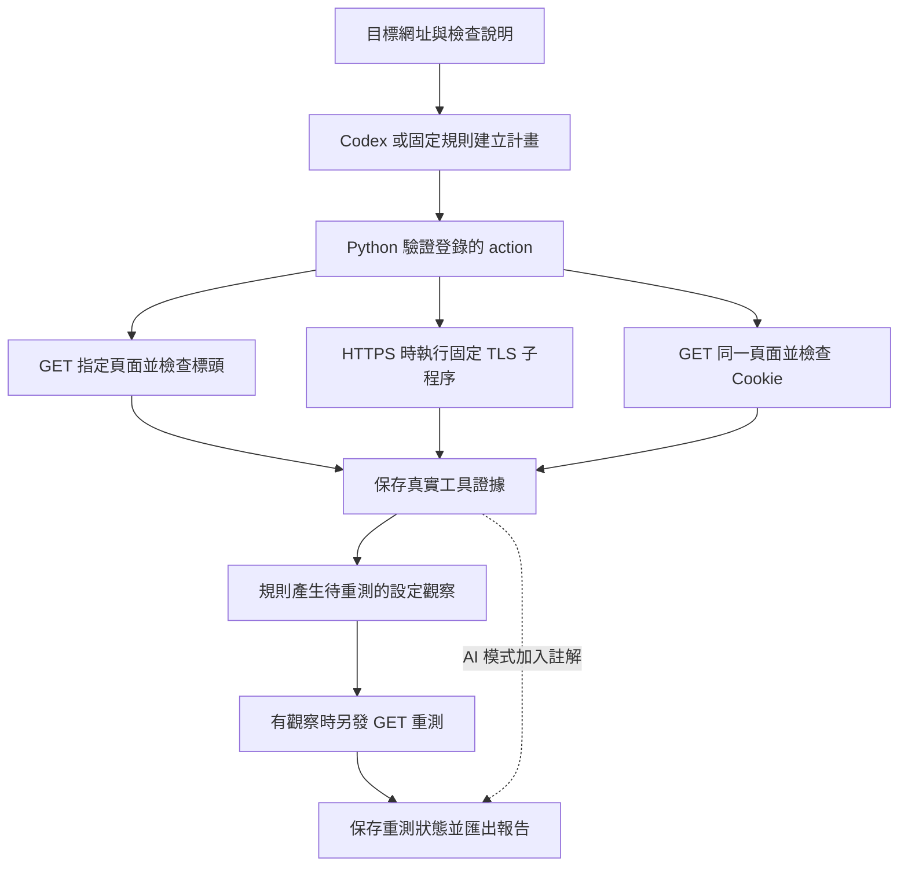

# 為什麼 AI 分析之外還需要獨立重測

看到 AI 寫出「發現問題」時，仍需要知道它依據哪一次回應，以及同樣的設定能否再次觀察。Sentinel Mini 把規劃、工具執行與重測分開，讓報告中的設定觀察能連回實際證據。

## Codex 選擇任務，Python 操作網站

Codex 根據檢查目標，從 `scan`、`command`、`request` 選擇最多三項任務。Python 驗證計畫後，才執行已登錄的工具。三類工具分別收集指定頁面的安全標頭、TLS 連線資訊與 Cookie 設定。

圖中的執行指令只代表固定的 Python TLS 子程序。檢查目標即使要求其他指令，也不會增加工具能力。AI 註解可以補充說明，但不會取代工具證據或改寫重測狀態。

規則模式會選取全部三項任務，因而適合第一次操作與比對已修正頁面。AI 模式可能只選取部分任務，所以不同計畫的觀察數量不能直接當成網站安全程度的比較。

## 可重現只回答同一設定是否再次出現

例如第一次 GET 沒有收到 CSP 標頭，程式會產生 `csp_missing` 觀察。確認階段另發 GET，若仍沒有 CSP，就記為 `confirmed`，並把兩次回應的證據 ID 放進同一項結果。

如果第二次取得可比較的 HTML，但缺口沒有再出現，狀態是 `not_reproduced`。這可能反映設定改變，也可能反映伺服器回應不同，不能據此保證問題永久修復。若第二次連線失敗，或回應不是可比較的成功 HTML，就記為 `inconclusive`。

缺少 CSP 只是少了一項瀏覽器防護設定。要證明 XSS，還需要另外的測試與證據，這個專案沒有提供該能力。同樣地，沒有觀察也只表示本次選取的規則未產生結果。

## 任務完成與網站安全是不同判斷

`completed` 描述工作流程已結束，沒有使流程降為 `partial` 的警告或失敗。它不保證每個網站功能都經過檢查。工具的 `done` 也只表示工具完成紀錄，例如 TLS 連線未驗證成功時，仍可能保存一筆失敗觀察。

`partial` 會保留已取得的證據，並提示你查看 warnings、工具 note 與無法確認的結果。模型服務故障時，程式不會偷偷改成規則模式，因為這會讓同一份報告混入未說明的執行條件。

## 本機執行仍可能把資料送往模型服務

瀏覽器介面與資料庫都在本機，但 Codex 需要連接模型服務。程式會提供目標、檢查說明、已遮蔽 Cookie 值的標頭、TLS 資訊與觀察。網頁本文不送給模型，卻會保存在本機證據中。

因此，本機執行不代表所有資料都不離開電腦。標頭和檢查說明仍可能包含敏感資訊，分享 JSON 或資料庫前也需要檢查內容。打包清單只能控制哪些檔案進入 ZIP，不能辨識原始碼中的所有秘密。

## 這個原型沒有檢查的範圍

程式只讀取指定頁面，不會登入、提交表單、帶入你的瀏覽器 Cookie 或爬取全站。重新導向不會自動跟隨，因為導向後的目標可能超出原先的授權範圍。

目前規則沒有測試 SQL injection、XSS、CSRF、登入授權或業務邏輯。Cookie 用途依名稱判斷，可能誤判。TLS 子程序會保存連線資訊，但沒有把 TLS 失敗轉成獨立 finding 的重測規則。

這些限制決定了結果適合用來學習流程與檢查少量網站設定。實際操作見[使用說明書](使用說明書.md)，完整狀態與預算見[參數與結果參考](參數與結果參考.md)。
